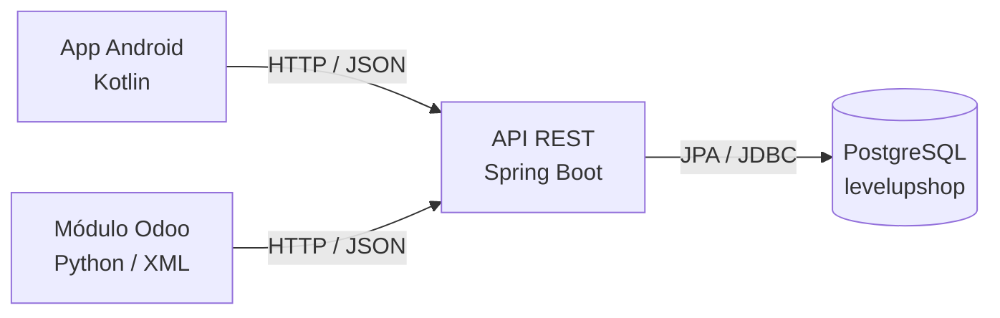
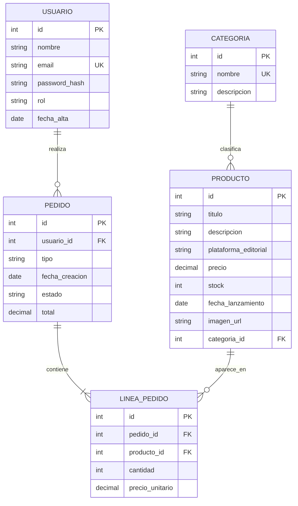
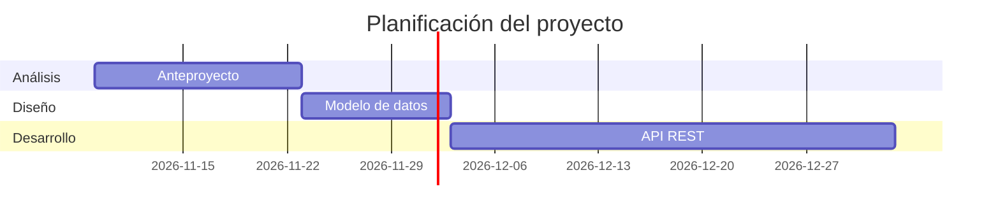

# LevelUp Shop

**Proyecto intermodular · 2º Desarrollo de Aplicaciones Multiplataforma**  
**IES Juan Bosco · Curso 2026-2027**

**Autor/a:** [Tu nombre y apellidos]  
**Repositorio:** https://github.com/[tu-usuario]/LevelUpShop

---

## Índice

1. [Introducción](#1-introducción)
2. [Análisis de requerimientos](#2-análisis-de-requerimientos)
3. [Diseño y planificación](#3-diseño-y-planificación)
4. [Implementación y pruebas](#4-implementación-y-pruebas)
5. [Documentación](#5-documentación)
6. [Mantenimiento y evolución](#6-mantenimiento-y-evolución)
7. [Conclusiones](#7-conclusiones)
8. [Declaración de uso de IA generativa](#8-declaración-de-uso-de-ia-generativa)
9. [Bibliografía y referencias](#9-bibliografía-y-referencias)

---

## 1. Introducción

### 1.1. Presentación del proyecto

**LevelUp Shop** es una aplicación multiplataforma diseñada para la gestión integral de una tienda especializada en cultura friki, centrada en la venta y reserva de **videojuegos, cómics/manga y merchandising**.

El proyecto se divide en dos áreas conectadas entre sí: por un lado, una **aplicación móvil Android** (desarrollada en Kotlin) orientada a los clientes y administradores, donde los usuarios pueden explorar el catálogo por apartados, realizar compras directas de artículos en stock o efectuar **reservas (*pre-orders*)** de próximos lanzamientos que todavía no han salido al mercado; por otro lado, un **módulo propio de Odoo** que actúa como sistema de gestión empresarial (ERP) para el control interno de inventario, demanda de reservas, clientes y pedidos. Toda la lógica de negocio y persistencia se centraliza mediante una **API REST en Spring Boot** conectada a una base de datos relacional en **PostgreSQL**.

### 1.2. Objetivos del proyecto

**Objetivo general:**

Desarrollar un ecosistema completo y funcional para una tienda de videojuegos, cómics y merchandising que integre una base de datos relacional, una API REST segura, una aplicación cliente Android usable y accesible, y un módulo personalizado de Odoo, aplicando los conocimientos adquiridos en todos los módulos de 2º DAM.

**Objetivos específicos:**

- Diseñar e implementar una base de datos relacional en PostgreSQL con al menos cuatro tablas relacionadas, claves primarias, claves foráneas y campos de fecha (como fechas de lanzamiento y de pedido), acompañada de un script SQL con datos de prueba ficticios.
- Desarrollar una API REST propia con Java y Spring Boot que exponga los endpoints necesarios en formato JSON, documentada y validada mediante pruebas unitarias.
- Implementar un sistema de autenticación seguro con registro y CRUD completo de usuarios, cifrado de contraseñas mediante hash y control de acceso diferenciado por roles (cliente y administrador).
- Crear una aplicación móvil nativa en Android con Kotlin que permita consultar el catálogo por categorías (videojuegos, cómics/manga y merchandising), filtrar productos, realizar compras directas, reservar próximos lanzamientos y consultar el historial de pedidos.
- Aplicar principios de diseño de interfaces, usabilidad y accesibilidad en la app cliente, incluyendo un logotipo original, validación de formularios y una sección «Sobre mí» con enlace al perfil profesional.
- Desarrollar un módulo propio en Odoo integrado con la lógica de la tienda para facilitar la gestión interna del stock, el catálogo y los pedidos/reservas desde el entorno ERP.

### 1.3. Justificación del proyecto

El sector de los videojuegos, el manga y el coleccionismo cuenta con un público muy activo que no solo compra productos disponibles, sino que depende en gran medida de las **reservas anticipadas** para asegurar ediciones limitadas o lanzamientos muy esperados. Sin embargo, muchas tiendas locales y comercios especializados siguen gestionando sus reservas de forma manual o con herramientas desconectadas de su inventario real, lo que provoca roturas de stock, errores en los avisos a clientes y pérdida de tiempo administrativo.

**LevelUp Shop** nace para resolver esa necesidad unificando la experiencia del comprador en el móvil con la gestión empresarial en Odoo. Al diferenciar automáticamente entre artículos disponibles para compra inmediata y lanzamientos futuros habilitados para reserva según su fecha de salida, el sistema aporta valor real tanto al cliente final como al equipo de la tienda. Además, desde el punto de vista académico y profesional, permite demostrar el dominio de una arquitectura realista y escalable, ideal para formar parte de un portfolio técnico.

---

## 2. Análisis de requerimientos

### 2.1. Identificación de necesidades y requerimientos

<!-- Pendiente para próximos hitos -->

**Requisitos funcionales**

| Código | Descripción | Prioridad |
|---|---|---|
| RF01 | El usuario puede registrarse en la aplicación | Alta |
| RF02 | | |

**Requisitos no funcionales**

| Código | Descripción |
|---|---|
| RNF01 | Las contraseñas se almacenan cifradas mediante hash |
| RNF02 | |

### 2.2. Identificación del público

<!-- Pendiente para próximos hitos -->

### 2.3. Estudio de mercado y competencia

<!-- Pendiente para próximos hitos -->

| Aplicación | Puntos fuertes | Puntos débiles | Diferencia con mi proyecto |
|---|---|---|---|
| | | | |

### 2.4. Protección de datos

<!-- Pendiente para próximos hitos -->

---

## 3. Diseño y planificación

### 3.1. Arquitectura del proyecto

**LevelUp Shop** sigue una arquitectura cliente-servidor desacoplada basada en una **API REST** centralizada que actúa como intermediaria entre la base de datos relacional y los distintos clientes:

- **Base de datos (PostgreSQL):** almacena de forma persistente los usuarios, categorías, productos (con su stock y fecha de lanzamiento), pedidos y líneas de pedido.
- **API REST (Java con Spring Boot):** expone los endpoints en formato JSON, gestiona la lógica de negocio (validación de stock, diferenciación entre compra directa y reserva según fecha de lanzamiento), la seguridad (hash de contraseñas y control por roles) y el acceso a datos mediante ORM (Spring Data JPA / Hibernate).
- **Cliente móvil (Android con Kotlin):** consume la API mediante peticiones HTTP/JSON para ofrecer la interfaz de tienda, reservas, gestión de perfil y administración a los usuarios.
- **Sistema ERP (Módulo propio de Odoo):** se integra con el ecosistema de la tienda (mediante peticiones HTTP a la API REST) para permitir la gestión interna de inventario, catálogo y seguimiento de pedidos y reservas desde el entorno empresarial.

**Tecnologías utilizadas**

| Componente | Tecnología | Versión prevista |
| --- | --- | --- |
| Base de datos | PostgreSQL | 16+ |
| API REST | Java / Spring Boot | Java 21 / Spring Boot 3.x |
| Cliente móvil | Android / Kotlin | Android SDK 34+ / Kotlin 2.x |
| ERP | Odoo (Python / XML) | Odoo 17 / 18 |
| Control de versiones | Git / GitHub | — |

### 3.2. Modelo de datos

La base de datos relacional (`levelupshop`) está compuesta inicialmente por **5 tablas** relacionadas mediante claves foráneas. Todas cuentan con un identificador numérico único como clave primaria (`id`) y se incluyen múltiples campos de tipo fecha (`fecha_alta`, `fecha_lanzamiento` y `fecha_creacion`) para gestionar el ciclo de vida de usuarios, reservas y compras.

**Descripción de las tablas:**

- **`USUARIO`:** almacena las cuentas registradas en la plataforma. Incluye el correo electrónico único, la contraseña cifrada mediante hash (`password_hash`), el rol asignado (`USER` o `ADMIN`) y la fecha de registro (`fecha_alta`).
- **`CATEGORIA`:** clasifica los distintos apartados de la tienda (por ejemplo: *Videojuegos*, *Cómics/Manga*, *Merchandising*).
- **`PRODUCTO`:** contiene el catálogo completo. El campo `plataforma_editorial` permite indicar la consola/PC (PS5, Switch, PC) o la editorial del cómic (Norma, Ivrea, Panini). El campo `fecha_lanzamiento` determina si el producto está disponible para compra inmediata o en modo reserva (*pre-order*).
- **`PEDIDO`:** registra cada operación realizada por un usuario. El campo `tipo` distingue entre `COMPRA` y `RESERVA`, mientras que `estado` refleja su situación (`PENDIENTE`, `RESERVADO`, `PREPARANDO`, `ENTREGADO`, `CANCELADO`).
- **`LINEA_PEDIDO`:** tabla intermedia que resuelve la relación muchos a muchos entre `PEDIDO` y `PRODUCTO`, guardando la cantidad y el precio unitario en el momento de la compra o reserva.

### 3.3. Diseño de la API

<!-- Pendiente para próximos hitos -->

| Método | Endpoint | Descripción | Requiere rol |
| --- | --- | --- | --- |
| POST | `/api/auth/login` | Inicio de sesión | — |
| GET | `/api/usuarios` | Lista de usuarios | Admin |

### 3.4. Diseño de la interfaz de usuario

<!-- Pendiente para próximos hitos -->

### 3.5. Planificación de tareas y recursos

<!-- Pendiente para próximos hitos -->

---

## 4. Implementación y pruebas

### 4.1. Desarrollo de las funcionalidades

<!-- Pendiente para próximos hitos -->

### 4.2. Seguridad

<!-- Pendiente para próximos hitos -->

### 4.3. Pruebas unitarias y de integración

<!-- Pendiente para próximos hitos -->

| Código | Qué se prueba | Resultado esperado | Resultado obtenido |
| --- | --- | --- | --- |
| P01 | Login con contraseña incorrecta | Mensaje de error, no se accede | |

### 4.4. Corrección de errores y optimización

<!-- Pendiente para próximos hitos -->

---

## 5. Documentación

### 5.1. Documentación técnica

<!-- Pendiente para próximos hitos -->

### 5.2. Manual de usuario

<!-- Pendiente para próximos hitos -->

### 5.3. Manual de instalación y configuración

<!-- Pendiente para próximos hitos -->

---

## 6. Mantenimiento y evolución

### 6.1. Posibles mejoras

<!-- Pendiente para próximos hitos -->

### 6.2. Actualizaciones futuras

<!-- Pendiente para próximos hitos -->

---

## 7. Conclusiones

### 7.1. Evaluación del proyecto

<!-- Pendiente para la entrega final -->

### 7.2. Cumplimiento de objetivos y requisitos

| Objetivo / requisito | ¿Cumplido? | Observaciones |
| --- | --- | --- |
| | | |

### 7.3. Lecciones aprendidas y recomendaciones

<!-- Pendiente para la entrega final -->

---

## 8. Declaración de uso de IA generativa

| Herramienta | Uso | Parte del proyecto | Revisión / adaptación realizada |
| --- | --- | --- | --- |
| Gemini | Lluvia de ideas, redacción inicial de la introducción y boceto de diagramas Mermaid | Apartados 1, 3.1 y 3.2 de `docs/memoria.md` | Revisión del contenido y adaptación a las tecnologías y requisitos específicos de LevelUp Shop |

---

## 9. Bibliografía y referencias

<!-- Añade aquí la documentación oficial y recursos que consultes durante el desarrollo -->

- Documentación oficial de Spring Boot: https://spring.io/projects/spring-boot
- Documentación oficial de PostgreSQL: https://www.postgresql.org/docs/
- Documentación oficial de Android Developers (Kotlin): https://developer.android.com/
- Documentación oficial de Odoo: https://www.odoo.com/documentation/
